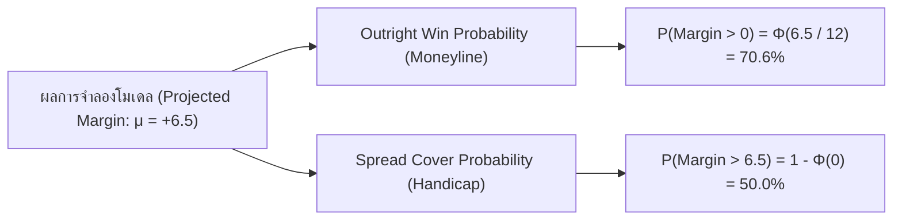

# คู่มือและระเบียบวิธีคำนวณราคาต่อรองเชิงปริมาณ (Quantitative Sports Betting & Market Making Guide)
> **เอกสารแม่บทว่าด้วยการกำหนดราคาต่อรอง, สถิติขั้นสูง, กลไกตลาด และการเงินเชิงปริมาณสำหรับบาสเกตบอล NBA**

> **สถานะ:** สมการทั่วไปเป็นข้อเสนอสำหรับการทดลอง ไม่ใช่ผล backtest ของโปรเจกต์ ตัวเลขตลาด/ทีมในกรณีศึกษาเป็นข้อมูลสมมติ และคำอธิบายพฤติกรรมหนังสือ/ผู้เดิมพันด้านล่างเป็นสมมติฐานทั่วไป ไม่ได้อนุมานจาก line movement ของโปรเจกต์

---

## สารบัญ (Table of Contents)
1. [ปรัชญาและโครงสร้างตลาดสมัยใหม่ (Market Microstructure & Philosophy)](#1-ปรัชญาและโครงสร้างตลาดสมัยใหม่)
2. [การวัดค่าน้ำและมาร์จิ้น: Overround vs Theoretical Hold](#2-การวัดค่าน้ำและมาร์จิ้น-overround-vs-theoretical-hold)
3. [การ De-vigging ขั้นสูง: การดึง True Probability ออกจากราคาตลาด](#3-การ-de-vigging-ขั้นสูง)
4. [รากฐานทางสถิติ: Win Probability vs Cover Probability](#4-รากฐานทางสถิติ-win-probability-vs-cover-probability)
5. [การสร้างโมเดลตัวเลขพื้นฐาน: Pace, Elo และ Expected Total](#5-การสร้างโมเดลตัวเลขพื้นฐาน)
6. [ตัวแปรปรับแต่งบริบทตามยุคสมัย (Modern Contextual Adjustments)](#6-ตัวแปรปรับแต่งบริบทตามยุคสมัย)
7. [บทบาทที่แท้จริงของการจำลอง Monte Carlo](#7-บทบาทที่แท้จริงของการจำลอง-monte-carlo)
8. [การประเมินคุณภาพโมเดลของ Quant (Model Validation & CLV)](#8-การประเมินคุณภาพโมเดลของ-quant)
9. [กรณีศึกษาการคำนวณจริงแบบ End-to-End (Boston vs Miami)](#9-กรณีศึกษาการคำนวณจริงแบบ-end-to-end)

---

## 1. ปรัชญาและโครงสร้างตลาดสมัยใหม่

### 1.1 วัตถุประสงค์ที่แท้จริงของเจ้ามือ (Sportsbook / Market Maker)
ในวงการพนันกีฬาระดับโลก มีความเข้าใจผิดอย่างแพร่หลายว่าเจ้ามือมีหน้าที่ **"คาดเดาผลการแข่งขันว่าใครจะชนะ"** แต่ในความเป็นจริง วัตถุประสงค์ของเจ้ามือคือ:
1. **การค้นหาราคาที่สะท้อนความน่าจะเป็นจริง (Price Discovery):** คำนวณความน่าจะเป็นของแต่ละผลลัพธ์ให้ใกล้เคียงความจริงมากที่สุดเพื่อไม่ให้ถูกนักเล่นมืออาชีพ (Sharps / Syndicates) เอาเปรียบ
2. **การบริหารความเสี่ยงและการรับ Position (Inventory & Exposure Management):** รับความเสี่ยงตามความมั่นใจของโมเดลภายใน และควบคุมยอดความเสียหายสูงสุด (Maximum Drawdown)

### 1.2 มายาคติเรื่อง "Balanced Book" และ "กำไรไร้ความเสี่ยง"
ทฤษฎีในตำราเรียนยุคเก้ามักระบุว่า *เจ้ามือจะปรับราคาเพื่อให้ยอดเงินเดิมพันสองฝั่งสมดุลกัน (50/50) เพื่อกินค่าน้ำ (Vig) โดยไม่มีความเสี่ยง*

**ความเป็นจริงในตลาดปัจจุบัน:**
* **ยอดเงินแทบไม่มีวันสมดุล:** ในความเป็นจริง เงินจะไหลไปฝั่งทีมเต็ง (Public Favorite) หรือแต้มสูง (Over) เสมอ
* **เจ้ามือรับ Exposure ตามมุมมองของตนเอง:** เจ้ามือสาย **Sharp Market Maker** (เช่น Pinnacle, Circa Sports, CRIS/Bookmaker) ไม่ได้พยายามทำให้เงินสองฝั่งเท่ากัน แต่พวกเขาใช้ข้อมูลการแทงของกลุ่ม Sharp Bettors ในการขยับราคาจนได้ **Consensus Fair Price** และกล้าถือ Position ตรงข้ามคนส่วนใหญ่ (Take a stand against the public) เพราะพวกเขารู้ว่าในระยะยาว ความน่าจะเป็นทางคณิตศาสตร์จะทำงานเข้าข้างพวกเขาเสมอ

### 1.3 ความแตกต่างระหว่างประเภทของ Sportsbook
* **Retail / Soft Books (เช่น Bet365, DraftKings, FanDuel):**
  * เน้นผู้เล่นทั่วไป (Recreational Bettors)
  * คิดมาร์จิ้นสูง (มาตรฐานเส้น Spread อยู่ที่ `-110 / -110` หรือ 20-cent line)
  * ใช้กลยุทธ์จำกัดวงเงิน (Limit / Ban) นักเล่นที่ทำกำไรหรือมีสัญญาณว่าเป็น Sharp
* **Sharp Books / Market Makers (เช่น Pinnacle, Circa Sports):**
  * รับการเดิมพันจากกลุ่ม Sharp และ Syndicates เพื่อทำ Price Discovery
  * คิดมาร์จิ้นต่ำมาก (Low-margin model เช่น `-104 / -105` หรือ 8 ถึง 10-cent line)
  * ไม่จำกัดวงเงินผู้เล่นที่ชนะ แต่ใช้เงินของพวกเขาเป็นตัวขับเคลื่อนราคาให้มีประสิทธิภาพสูงสุด

---

## 2. การวัดค่าน้ำและมาร์จิ้น: Overround vs Theoretical Hold

คำว่า **"Vig"**, **"Overround"**, และ **"Hold"** มักถูกนำมาใช้ปนกัน แต่ในทางคณิตศาสตร์การเงินมีความแตกต่างกันอย่างมีนัยสำคัญ:

### 2.1 Overround (มาร์จิ้นส่วนเกินบนความน่าจะเป็น)
Overround คือผลรวมของ Implied Probability ของทุกผลลัพธ์ในตลาดที่เกิน $100\%$:
$$\text{Overround} = \sum_{i=1}^n \frac{1}{\text{Decimal Odds}_i}$$
$$\text{Overround Percentage} = (\text{Overround} - 1.0) \times 100\%$$

### 2.2 Theoretical Hold (เปอร์เซ็นต์กำไรที่แท้จริงจาก Handle)
Hold คือสัดส่วนกำไรที่เจ้ามือคาดหวังว่าจะเก็บได้จากยอดเงินเดิมพันรวมทั้งหมด (Handle) ภายใต้สมมติฐานว่าเงินกระจายตัวตามสัดส่วนของราคา:
$$\text{Theoretical Hold} = 1 - \frac{1}{\text{Overround}} = \frac{\text{Overround} - 1}{\text{Overround}}$$

### ตัวอย่างเปรียบเทียบมาตรฐานราคา:
| รูปแบบราคา (Odds) | Implied Probs รวม | Overround | Theoretical Hold |
| :--- | :--- | :--- | :--- |
| **Retail Spread (-110 / -110)** | $52.38\% + 52.38\%$ | **104.76% (+4.76%)** | **4.55%** |
| **Sharp Spread (-105 / -105)** | $51.22\% + 51.22\%$ | **102.44% (+2.44%)** | **2.38%** |
| **Super-Sharp (-104 / -104)** | $50.98\% + 50.98\%$ | **101.96% (+1.96%)** | **1.92%** |

> [!IMPORTANT]
> **ข้อพึงระวัง:** ค่า $4.76\%$ คือ Overround ส่วน $4.55\%$ คือ Hold จริงของเจ้ามือ การระบุว่าเจ้ามือกิน $4.76\%$ จากเงินเดิมพันทั้งหมดจึงเป็นการคำนวณที่คลาดเคลื่อน

---

## 3. การ De-vigging ขั้นสูง

การถอดค่าน้ำ (De-vigging) เพื่อหาความน่าจะเป็นที่แท้จริง (**True Probability: $p_i$**) จากราคาตลาดดิบ ($q_i = 1/\text{Decimal Odds}_i$) มี 3 วิธีหลัก:

### 3.1 วิธีที่ 1: Multiplicative Normalization (วิธีดั้งเดิม)
เป็นวิธีที่ง่ายที่สุด โดยนำความน่าจะเป็นดิบมาหารด้วย Overround ทั้งหมด:
$$p_i = \frac{q_i}{\sum_{j=1}^n q_j}$$
* **ข้อจำกัด:** วิธีนี้สมมติว่าเจ้ามือใส่ค่าน้ำลงในทุกผลลัพธ์เท่ากันเป็นสัดส่วนคงที่ ซึ่งขัดกับหลักจิตวิทยาและข้อมูลเชิงประจักษ์ เพราะในตลาดจริงมีปรากฏการณ์ **Favorite-Longshot Bias** (เจ้ามือจะบวกค่าน้ำลงในทีมรอง/ตัวจ่ายหนัก มากกว่าทีมเต็ง)

---

### 3.2 วิธีที่ 2: Power (Geometric) Method
แก้ปัญหา Favorite-Longshot Bias โดยการยกกำลัง $k$ ให้กับความน่าจะเป็นดิบ:
$$p_i = q_i^k \quad \text{โดยที่ } k > 1 \text{ ถูกหาจนกระทั่ง } \sum_{i=1}^n q_i^k = 1.0$$
เนื่องจาก $k > 1$ ตัวเลขที่มีค่าน้อย (ทีมรอง) จะถูกลดทอนลงเร็วกว่าตัวเลขที่มีค่ามาก (ทีมเต็ง) ทำให้สะท้อนโอกาสจริงของทีมเต็งได้แม่นยำขึ้น

---

### 3.3 วิธีที่ 3: Shin's Method (Gold Standard ของวงการ Quant)
พัฒนาโดย Hyun Song Shin (1992, 1993) อิงตามทฤษฎีจุลภาคของตลาดการเงิน (Market Microstructure) โดยสมมติว่าในตลาดมีผู้เล่น 2 กลุ่ม:
1. **Uninformed Bettors ($1 - z$):** ผู้เล่นทั่วไปที่ไม่มีข้อมูลวงใน
2. **Informed Bettors ($z$):** ผู้เล่นวงในหรือ Sharp ที่มีข้อมูลจริงและจะแทงเฉพาะฝั่งที่ชนะเท่านั้น

สมการของแบบจำลอง Shin สำหรับความน่าจะเป็น $p_i$:
$$p_i = \frac{\sqrt{z^2 + 4(1 - z)\left(\frac{q_i^2}{S}\right)} - z}{2(1 - z)}$$
โดยที่ $S = \sum q_j$ (Overround) และพารามิเตอร์ $z$ ถูกหาผ่านการค้นหารากของสมการ (Numerical Root Finding / Bisection) จนกระทั่ง $\sum_{i=1}^n p_i = 1.0$

* **ข้อจำกัด:** $z$ เป็นพารามิเตอร์แฝงภายใต้สมมติฐานของแบบจำลอง ไม่ใช่การวัดสัดส่วนผู้เล่นวงในหรือเงินมืออาชีพโดยตรง

---

## 4. รากฐานทางสถิติ: Win Probability vs Cover Probability

นี่คือจุดตัดที่สำคัญที่สุดในการทำความเข้าใจการต่อรองในกีฬาบาสเกตบอล:

### 4.1 การแจกแจงของผลต่างคะแนนใน NBA (Score Differential Distribution)
Normal Distribution เป็น baseline สมมติฐานได้ แต่โปรเจกต์ยังไม่มีผลคำนวณ residual ที่ยืนยันรูปทรงหรือค่า sigma สำหรับ margin/total จึงไม่ควรถือว่า 12 แต้มเป็นค่ามาตรฐานที่ผ่านการ fit ปัจจุบันใช้ sigma 12.5 แต้มเป็น fallback ที่ระบุว่าไม่ผ่าน calibration; เมื่อมี residual จาก forecast ที่บันทึกไว้ จะใช้ข้อมูลก่อนหน้าเท่านั้น

### 4.2 Outright Win Probability (โอกาสชนะเกม / Moneyline)
โอกาสที่ทีมเต็งจะชนะการแข่งขันโดยตรงคือความน่าจะเป็นที่ผลต่างคะแนน $\text{Margin} > 0$:
$$P(\text{Win}) = \Phi\left(\frac{\mu_{\text{margin}}}{\sigma}\right)$$
*สมมติทีมต่อมีแต้มคาดหวังชนะ $\mu = +6.5$ แต้ม:*
$$Z = \frac{6.5 - 0}{12.0} \approx 0.5417 \implies P(\text{Win}) = \Phi(0.5417) \approx 70.60\%$$

### 4.3 Spread Cover Probability (โอกาสชนะเกินแต้มต่อ)
หากเจ้ามือเปิดราคาแต้มต่อที่เส้น $L$ (เช่น Boston Celtics ต่อ $-6.5$ แต้ม):
ทีมต่อจะชนะแต้มต่อก็ต่อเมื่อ $\text{Actual Margin} > -L$ (คือชนะเกิน $6.5$ แต้ม):
$$P(\text{Cover Spread } L) = 1 - \Phi\left(\frac{-L - \mu}{\sigma}\right) = \Phi\left(\frac{\mu + L}{\sigma}\right)$$

> [!CAUTION]
> **การแยกแยะ:**
> * หากเส้นที่เปิดคือ **Fair Spread** ($L = -6.5$ และโมเดลทำนายได้ $\mu = +6.5$):
>   $$P(\text{Cover}) = \Phi\left(\frac{6.5 - 6.5}{12.0}\right) = \Phi(0) = 50.00\%$$
> * **โอกาสกินแต้มต่อคือ 50% ไม่ใช่ 70.6%!** ค่า $70.6\%$ คือโอกาสชนะแบบไม่ต่อแต้ม (Moneyline)

### 4.4 ข้อจำกัดของ Normal Distribution
* **ความเป็นจำนวนเต็ม (Discrete Distribution):** แต้มบาสเกตบอลเกิดขึ้นเป็นจำนวนเต็มเท่านั้น
* **หางข้อมูลหนากว่าปกติ (Fat Tails / Leptokurtic):** ในความเป็นจริง เกมที่มีการนำห่างมากๆ ช่วงท้ายเกม โค้ชมักส่งตัวสำรองลง (Garbage Time) หรือทีมที่ตามอยู่จะใช้แท็กติก Foul Game ทำให้ผลต่างคะแนนที่หางข้อมูลมีความแปรปรวนมากกว่า Normal Distribution ปกติเล็กน้อย

---

## 5. การสร้างโมเดลตัวเลขพื้นฐาน

### 5.1 การคำนวณจำนวนการครองบอลคาดหวัง (Expected Pace)
Pace คือจำนวน Possessions ต่อ 48 นาทีของแต่ละทีม:

1. **โมเดล Additive (แนะนำเป็น Baseline):**
   $$\text{Pace}_{\text{expected}} = \text{Pace}_A + \text{Pace}_B - \text{Pace}_{\text{league}}$$
2. **โมเดล Multiplicative:**
   $$\text{Pace}_{\text{expected}} = \frac{\text{Pace}_A \times \text{Pace}_B}{\text{Pace}_{\text{league}}}$$

*ตัวอย่าง:* Boston (98.0), Miami (96.0), ค่าเฉลี่ยลีก (99.0):
* Additive: $98.0 + 96.0 - 99.0 = 95.0$ ครั้ง
* Multiplicative: $(98.0 \times 96.0) / 99.0 = 95.03$ ครั้ง

### 5.2 การคำนวณแต้มรวมคาดหวัง (Expected Total)
แต้มรวมต้องคำนวณจาก Adjusted Offensive Rating ($\text{Adj ORtg}$) ของทั้งสองทีมอย่างโปร่งใส:
$$\text{Expected Total} = \frac{\text{Expected Pace}}{100} \times (\text{Adj ORtg}_{\text{Home}} + \text{Adj ORtg}_{\text{Away}})$$

*ตัวอย่าง:* Expected Pace = 95.0, Boston Adj ORtg = 116.0, Miami Adj ORtg = 114.0:
$$\text{Expected Total} = \frac{95.0}{100} \times (116.0 + 114.0) = 0.95 \times 230.0 = 218.5 \text{ แต้ม}$$

### 5.3 สูตร FiveThirtyEight MOV Elo ที่ถูกต้อง
สูตรคำนวณตัวคูณ Margin of Victory (MOV) ของระบบ Elo:
$$\text{MOV}_{\text{multiplier}} = \frac{(|\text{Margin}| + 3)^{0.8}}{7.5 + 0.006 \times \Delta\text{Elo}_{\text{winner}}}$$
โดยที่:
* $|\text{Margin}|$ คือ ผลต่างคะแนนของการแข่งขัน ($|\text{Winner Score} - \text{Loser Score}|$)
* $\Delta\text{Elo}_{\text{winner}} = \text{Elo}_{\text{winner}} - \text{Elo}_{\text{loser}}$ ก่อนเกม รวม home advantage ใน Elo difference ตามวิธี FiveThirtyEight; ต้องมีเครื่องหมาย และผู้ชนะที่เป็น underdog ได้ค่าติดลบ
* **กลไกการทำงาน:** หากทีมเต็งถล่มทีมรอง ($\Delta\text{Elo} > 0$) ตัวหารจะใหญ่ขึ้น ทำให้ตัวคูณลดลง เพื่อไม่ให้ทีมเต็งได้คะแนนเฟ้อ แต่หากทีมรองพลิกล็อกชนะ ($\Delta\text{Elo} < 0$) ตัวหารจะเล็กลง ทำให้ตัวคูณขยายขึ้น

---

## 6. ตัวแปรปรับแต่งบริบทตามยุคสมัย (Modern Contextual Adjustments)

### 6.1 การ Neutralize Net Rating ก่อนใส่ HCA
Net Rating ตลอดทั้งฤดูกาลของทีมใดๆ คำนวณจากผลงานรวมทั้งเกมในบ้านและนอกบ้าน หากนำ Net Rating ดิบมาใช้แล้วบวก HCA เพิ่มทันที จะเป็นการ **นับความได้เปรียบในบ้านซ้ำ (Double-counting)**:
สมการต่อไปนี้เป็น approximation ภายใต้ตารางแข่งที่สมดุลและ HCA ที่กำหนดจากข้อมูลฝึกเท่านั้น; ยังไม่ได้นำไปใช้ใน predictor ปัจจุบัน
$$\text{Neutral NetRating} = \text{Raw NetRating} - \left(\frac{\text{Home Games}}{\text{Total Games}} - 0.5\right) \times 2 \times \text{HCA}_{\text{eff}}$$

### 6.2 รูปแบบ Shrinkage ที่อาจทดสอบได้
สูตรทั่วไปสำหรับหดค่าประมาณเข้าหา prior คือ:
$$\text{NetRating}_{\text{shrunk}} = \frac{N}{N + K} \text{NetRating}_{\text{observed}} + \frac{K}{N + K} \text{Prior}$$
ค่า $K$ และ prior ต้อง fit ด้วยข้อมูลฝึกและเลือกจาก validation ตามเวลา โปรเจกต์ยังไม่มีหลักฐานรองรับค่า $K$ เฉพาะ จึงไม่ใช้สูตรนี้ใน projection ปัจจุบัน

### 6.3 อัปเดตสถิติบริบท NBA ปัจจุบัน (2020s Decade)
* **HCA และ Rest:** โปรเจกต์ยังไม่มีค่าที่ fit จาก time-series backtest เพื่อใช้เป็นตัวปรับคะแนน จึงไม่นำสัมประสิทธิ์คงที่มาเพิ่มใน projected score; ค่า split ใช้เป็นข้อมูลบรรยายเท่านั้น
* **เมทริกซ์ประเมินผู้เล่น (Player Impact Metrics):**
  * FiveThirtyEight ปิดตัวลงในปี 2023 ทำให้เมทริกซ์ **RAPTOR ยุติการพัฒนา**
  * ปัจจุบัน Quant นิยมใช้:
    1. **EPM (Estimated Plus-Minus)** จาก Dunks & Threes
    2. **DARKO (Daily D-RAPM)** โมเดล Machine Learning แบบ Real-time
    3. **LEBRON** จาก BBall-Index

### 6.4 Key Numbers: ทำไมสำคัญใน NFL แต่ไม่สำคัญใน NBA
* ใน **NFL (อเมริกันฟุตบอล):** แต้มเกิดขึ้นเป็นกลุ่มก้อนชัดเจน เช่น Touchdown + Extra Point ($7$ แต้ม) หรือ Field Goal ($3$ แต้ม) ทำให้ผลต่างคะแนนกระจุกตัวอยู่ที่เลข **3, 7, 6, 10, 14, 4** (Key Numbers) การขยับเส้นจาก $-3.0$ ไป $-3.5$ มีมูลค่ามหาศาล
* ใน **NBA (บาสเกตบอล):** การทำคะแนนเกิดขึ้นทีละ $1, 2, 3$ แต้ม และคะแนนรวมสูงกว่า $200$ แต้ม ทำให้ผลต่างคะแนนกระจายตัวสม่ำเสมอแทบจะเป็นระนาบเรียบ การปัดราคาแต้มต่อเป็นจำนวนเต็มหรือครึ่งแต้ม (เช่น $-11.0$ หรือ $-11.5$) เป็นเรื่องของ **Market Tick Size** และการบริหาร Exposure ของเจ้ามือ ไม่ใช่เรื่องของ Key Numbers

---

## 7. บทบาทที่แท้จริงของการจำลอง Monte Carlo

การจำลองแบบ Possession-by-Possession 100,000 ครั้ง ไม่ได้ทำให้โมเดลแม่นยำขึ้นโดยอัตโนมัติ เพราะอยู่ภายใต้กฎเหล็ก:
$$\text{Garbage In, Garbage Out (GIGO)}$$

### ลำดับการทำงานที่ถูกต้อง:
1. **Parametric & Regression Model:** สร้างสมการทำนาย Margin และ Total พื้นฐานให้ถูกต้องเป็นกระดูกสันหลังก่อน
2. **Monte Carlo Simulation:** นำมาใช้ต่อยอดเมื่อต้องการวิเคราะห์ตลาดที่มีความซับซ้อน เช่น:
   * **Same Game Parlays (SGP):** การหาค่า Correlation ระหว่างสถิติผู้เล่นกับผลรวมแต้ม
   * **Alternative Lines:** การประเมินราคาแต้มต่อทางเลือกที่อยู่บริเวณหางของการแจกแจง
   * **Live Betting (In-Play):** การจำลองเวลาและจำนวน Possessions ที่เหลืออยู่ในเกม

---

## 8. การประเมินคุณภาพโมเดลของ Quant (Model Validation & CLV)

ในโลกการเงินเชิงปริมาณ **Win Rate ไม่ใช่ตัวชี้วัดความสามารถของโมเดล** (เพราะคนที่แทงทีมเต็ง $-500$ ชนะ 80% ก็ยังขาดทุนได้) Quant ใช้ตัววัด 3 ตัวนี้เป็นหลัก:

### 8.1 Brier Score
วัดความแม่นยำของการพยากรณ์ความน่าจะเป็น (Mean Squared Error ของ Probability):
$$\text{Brier Score} = \frac{1}{N} \sum_{i=1}^N (p_i - y_i)^2$$
* $p_i$ คือ ความน่าจะเป็นที่โมเดลประเมิน ($0.0$ ถึง $1.0$)
* $y_i$ คือ ผลการแข่งจริง ($1$ หากเกิด, $0$ หากไม่เกิด)
* **เกณฑ์:** ยิ่งเข้าใกล้ $0.0$ ยิ่งแม่นยำ (การเดาสุ่มแบบ $50/50$ จะได้ค่า $0.25$)

### 8.2 Binary Logarithmic Loss (Cross-Entropy)
วัดการลงโทษโมเดลที่มั่นใจผิดทาง:
$$\text{Log Loss} = -\frac{1}{N} \sum_{i=1}^N [y_i \ln(p_i) + (1 - y_i) \ln(1 - p_i)]$$

### 8.3 Closing Line Value (CLV) — เครื่องชี้วัดความเฉียบคมอันดับหนึ่ง
ราคาปิดอาจใช้เป็น benchmark ของตลาดเมื่อระบุผู้ให้ราคาและเวลาได้ แต่ไม่ถือว่าเป็นค่าความน่าจะเป็นจริงที่ปราศจาก error

$$\text{CLV} = \left(\frac{\text{Decimal Odds}_{\text{bet}}}{\text{Decimal Odds}_{\text{close}}} - 1\right) \times 100\%$$
* CLV บวกหมายถึงราคาที่บันทึกไว้ดีกว่าราคาปิดตามนิยามที่เลือก แต่ไม่รับรองกำไรหรือความมีนัยสำคัญทางสถิติ ต้องพิจารณาราคาจริง ค่าน้ำ ขนาดตัวอย่าง และช่วงความไม่แน่นอนของผลตอบแทนร่วมด้วย

---

## 9. กรณีศึกษาการคำนวณจริงแบบ End-to-End

### คู่แข่งขัน: Boston Celtics (เหย้า) vs Miami Heat (เยือน)

#### ขั้นที่ 1: การเตรียมข้อมูลและ Neutralize Net Rating
* สมมติฐานสถิติฤดูกาล:
  * Boston: Pace $98.0$, Net Rating $+10.2$ (ลงเล่น เหย้า 22 นัด, เยือน 18 นัด)
  * Miami: Pace $96.0$, Net Rating $+1.2$ (ลงเล่น เหย้า 19 นัด, เยือน 21 นัด)
  * ค่าเฉลี่ยลีก: Pace $99.0$, HCA พื้นฐาน $= 1.8$ แต้ม
* **Neutralize Boston Net Rating:**
  $$\text{Home Bias} = \left(\frac{22}{40} - 0.5\right) \times 2 \times 1.8 = 0.05 \times 3.6 = +0.18$$
  $$\text{Adj NetRating}_{\text{BOS}} = 10.2 - 0.18 = +10.02$$
* **Neutralize Miami Net Rating:**
  $$\text{Home Bias} = \left(\frac{19}{40} - 0.5\right) \times 2 \times 1.8 = -0.025 \times 3.6 = -0.09$$
  $$\text{Adj NetRating}_{\text{MIA}} = 1.2 - (-0.09) = +1.29$$

#### ขั้นที่ 2: การคำนวณ Expected Pace
* ใช้โมเดล Additive:
  $$\text{Expected Pace} = 98.0 + 96.0 - 99.0 = 95.0 \text{ ครั้ง}$$

#### ขั้นที่ 3: การคำนวณ Expected Margin & Fair Spread
* ผลต่างประสิทธิภาพพื้นฐาน:
  $$\text{Base Margin} = (10.02 - 1.29) \times \frac{95.0}{100} = 8.73 \times 0.95 = +8.29 \text{ แต้ม}$$
* **ปรับปัจจัยแวดล้อม:**
  * Boston Home Court Advantage: $+1.80$ แต้ม
  * Miami เหนื่อยล้าจาก Back-to-Back: $+1.00$ แต้มให้ Boston
  * ตัวเจ็บ (Center ตัวจริง Boston พัก คิดตาม EPM): $-1.50$ แต้ม
* **Fair Spread สุทธิ:**
  $$\mu_{\text{margin}} = 8.29 + 1.80 + 1.00 - 1.50 = +9.59 \text{ แต้ม (Boston ต่อ 9.59 แต้ม)}$$

#### ขั้นที่ 4: การคำนวณ Win Probability & Fair Moneyline
* กำหนด $\sigma = 12.0$ แต้ม:
  $$Z = \frac{9.59}{12.0} \approx 0.7992$$
  $$P(\text{Boston Wins}) = \Phi(0.7992) \approx 78.79\%$$
  $$P(\text{Miami Wins}) = 1 - 0.7879 = 21.21\%$$
* **แปลงเป็น Fair Odds (ก่อนใส่ Vig):**
  * Boston Fair Decimal: $1 / 0.7879 \approx 1.269$ (American: $-371$)
  * Miami Fair Decimal: $1 / 0.2121 \approx 4.715$ (American: $+371$)

#### ขั้นที่ 5: การคำนวณ Expected Total (แต้มรวม)
* Boston Adj ORtg $= 117.0$, Miami Adj ORtg $= 113.0$:
  $$\text{Expected Total} = \frac{95.0}{100} \times (117.0 + 113.0) = 0.95 \times 230.0 = 218.5 \text{ แต้ม}$$

#### ขั้นที่ 6: การเปิดราคาตลาดและการใส่ค่าน้ำ (Market Pricing)
* **Spread ตลาด:** เปิด **Boston Celtics -9.5** ที่ราคาน้ำ **-110** (1.91) ทั้งสองฝั่ง
  * Overround $= 104.76\%$, Hold $= 4.55\%$
  * โอกาส Cover ที่เส้น $-9.5$ ($\text{Margin} = +9.59$):
    $$Z_{\text{cover}} = \frac{9.59 - 9.5}{12.0} = \frac{0.09}{12.0} = +0.0075 \implies P(\text{Cover}) \approx 50.3\%$$
    *(ใกล้เคียง 50% ตามหลักสมดุลของเส้นต่อรอง)*
* **Over/Under ตลาด:** เปิด **218.5 แต้ม** ที่ราคาน้ำ **-110 / -110**
